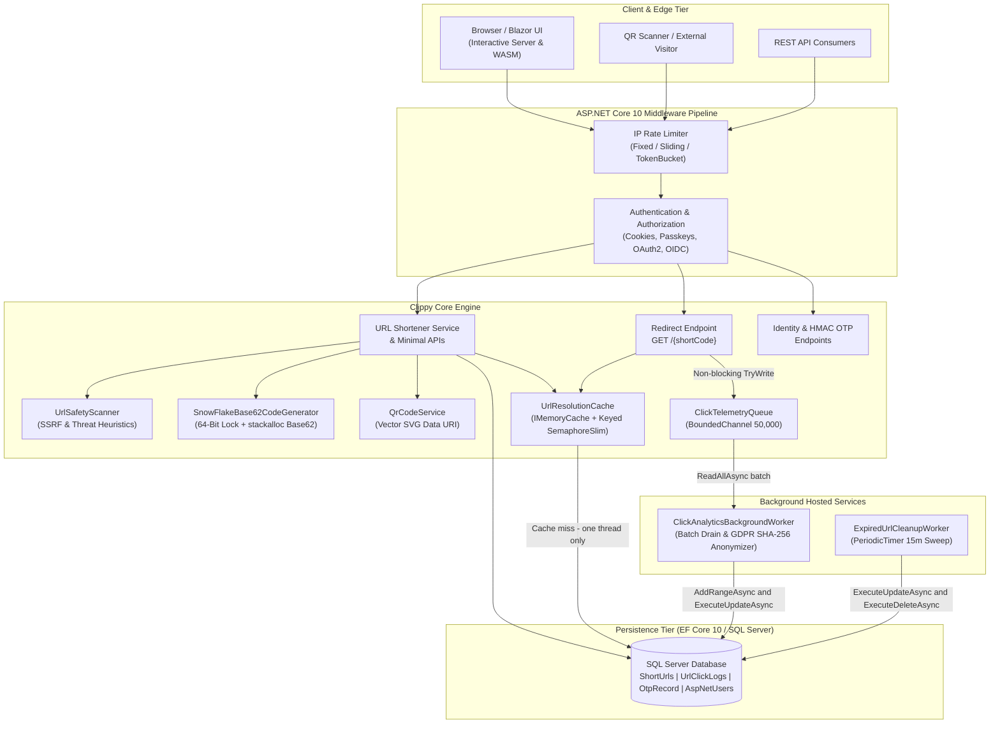

# Clippy.io — Enterprise URL Shortener, QR Engine & Real-Time Telemetry Platform

[](https://dotnet.microsoft.com/)
[](https://dotnet.microsoft.com/apps/aspnet/web-apps/blazor)
[](https://learn.microsoft.com/ef/core/)
[](./Dockerfile)
[](#system-architecture)

**Clippy.io** is a high-throughput, low-latency URL shortening, vector QR code generation, and GDPR-compliant click analytics platform built with **.NET 10**, **ASP.NET Core**, **Blazor**, and **Entity Framework Core 10**.

Designed to handle viral traffic spikes without database bottlenecks, Clippy combines **64-bit Snowflake-style ID generation**, **keyed `SemaphoreSlim` cache protection**, **non-blocking telemetry ingestion**, and **zero-trust identity** with passkeys, TOTP, HMAC OTP, and OAuth2/OIDC support.

---

## System Architecture



---

## Key Features

- Collision-free short-code generation using a custom 64-bit Snowflake-style identifier
- Keyed `SemaphoreSlim` protection against cache stampedes during viral traffic spikes
- Non-blocking click telemetry with GDPR-safe anonymization
- SSRF and phishing prevention for submitted URLs
- Multi-algorithm IP rate limiting
- Zero-trust identity with passkeys, TOTP, OTP, and OAuth2/OIDC
- Self-healing janitor worker for expired links and stale audit records

---

## Solution Structure

```text
Clippy/
├── Clippy/                       # ASP.NET Core 10 server and Blazor host
│   ├── Components/              # UI and account pages
│   ├── Data/                    # EF Core context, migrations, and schema
│   ├── EndPoints/               # Auth, redirect, and URL API endpoints
│   ├── Entities/                # Domain entities
│   ├── Extensions/              # Auth, rate limiting, and health probes
│   ├── Services/                # Security, caching, analytics, QR, and shortening
│   ├── Tests/                   # Concurrency and security tests
│   └── wwwroot/                 # Static assets and CSS
├── Clippy.Client/               # Blazor client and shared DTOs
├── Dockerfile                   # Multi-stage .NET 10 container build
├── docker-compose.yml           # Full-stack orchestration
├── Clippy.slnx                 # Solution file
├── NuGet.Config                 # NuGet configuration
├── README.md                   # Project overview and setup
└── .gitignore                  # Git ignore rules
```

---

## Getting Started

### Option A: Docker Compose

```bash
docker compose up --build -d
```

- Web application: `http://clippy.runasp.net`
- Health probe: `http://clippy.runasp.net/healthz`

### Option B: Local .NET 10 CLI

1. Ensure **.NET 10 SDK** and **SQL Server LocalDB** (or SQL Server Express) are installed.
2. Apply EF Core migrations:

   ```bash
   dotnet ef database update --project Clippy/Clippy.csproj
   ```

3. Run the server:

   ```bash
   dotnet run --project Clippy/Clippy.csproj
   ```

4. Navigate to `https://clippy.runasp.net`.

---

## Verification

Clippy includes an engineering test suite under `Clippy/Tests/` for:

- Snowflake concurrency validation
- Cache stampede protection
- URL safety and SSRF checks
- OTP brute-force protections

This README issue is fixed by removing the Mermaid edge labels that GitHub rejects during parsing.
