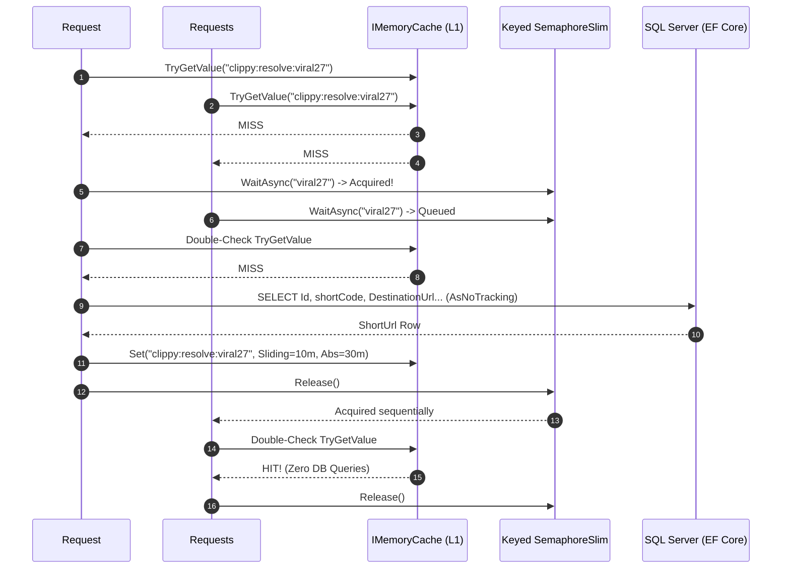
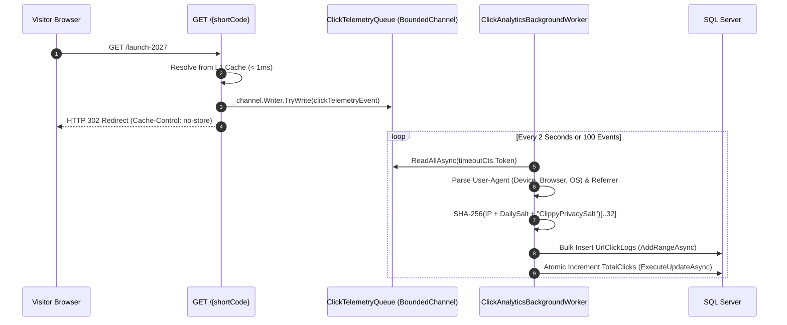

# Clippy.io — Enterprise URL Shortener, QR Engine & Real-Time Telemetry Platform

[](https://dotnet.microsoft.com/)
[](https://dotnet.microsoft.com/apps/aspnet/web-apps/blazor)
[](https://learn.microsoft.com/ef/core/)
[](./Dockerfile)
[](#system-architecture)

**Clippy.io** is a high-throughput, low-latency URL shortening, vector QR code generation, and GDPR-compliant click analytics platform engineered on **.NET 10**, **ASP.NET Core Minimal APIs**, **Blazor Interactive Server/WebAssembly**, and **Entity Framework Core 10**.

Designed from the ground up to handle viral traffic spikes without database bottlenecks, Clippy combines **64-bit Snowflake Base62 ID generation**, **keyed `SemaphoreSlim` cache-stampede protection**, **non-blocking `System.Threading.Channels` telemetry ingestion**, and **Zero-Trust multi-modal authentication** (WebAuthn Passkeys, TOTP 2FA with vector QR provisioning, HMAC-SHA256 OTP, Google/Meta OAuth 2.0, and Enterprise OIDC).

---

## Table of Contents

1. [Key Enterprise Engineering Highlights](#1-key-enterprise-engineering-highlights)
2. [System Architecture](#2-system-architecture)
3. [Core Workflows & Deep-Dive Engineering Logics](#3-core-workflows--deep-dive-engineering-logics)
   - [3.1 Lock-Free / Low-Contention 64-Bit Snowflake Base62 ID Generator](#31-64-bit-snowflake-base62-id-generator)
   - [3.2 Keyed SemaphoreSlim L1 Cache Stampede Protection](#32-keyed-semaphoreslim-l1-cache-stampede-protection)
   - [3.3 Non-Blocking Channel Click Telemetry & GDPR Anonymization](#33-non-blocking-channel-click-telemetry--gdpr-anonymization)
   - [3.4 SSRF & Threat Heuristic URL Safety Scanner](#34-ssrf--threat-heuristic-url-safety-scanner)
   - [3.5 Multi-Algorithm IP Rate Limiting](#35-multi-algorithm-ip-rate-limiting)
   - [3.6 Zero-Trust Identity: Passkeys, TOTP 2FA, HMAC OTP & OAuth2/OIDC](#36-zero-trust-identity-passkeys-totp-2fa-hmac-otp--oauth2oidc)
   - [3.7 Self-Healing Background Janitor Worker](#37-self-healing-background-janitor-worker)
4. [Solution Structure](#4-solution-structure)
5. [API Endpoints Reference](#5-api-endpoints-reference)
6. [Getting Started (Local & Docker Deployment)](#6-getting-started-local--docker-deployment)
7. [Verification & Concurrency Test Suite](#7-verification--concurrency-test-suite)

---

## 1. Key Enterprise Engineering Highlights

| Capability | Engineering Implementation | Why It Matters at Scale |
| :--- | :--- | :--- |
| **Collision-Free ID Generation** | Custom 64-bit Snowflake generator (`[41-bit Timestamp \| 10-bit Node \| 12-bit Sequence]`) encoded into Base62 via `stackalloc char[16]` | Generates up to **4,096 unique IDs per millisecond per node** (4.09M IDs/sec) with **zero database round-trips** or `NEWID()` index fragmentation. |
| **Cache Stampede Prevention** | `IMemoryCache` + per-key `ConcurrentDictionary<string, SemaphoreSlim>` double-checked locking + 30s Negative Cache | When a link goes viral and 500+ concurrent requests miss the cache simultaneously, **exact 1 SQL query** executes while the other 499 wait microseconds for cache hydration. |
| **Sub-Millisecond Redirects** | Bounded `Channel<clickTelemetryEvent>(50_000)` (`DropOldest` backpressure) + `ClickAnalyticsBackgroundWorker` | HTTP `302 Found` redirects never block on SQL `INSERT`/`UPDATE` I/O. Click events are drained in batches of up to 100 every 2 seconds. |
| **GDPR Privacy by Design** | Daily rotating salt + `SHA256.HashData("{Ip}:{yyyy-MM-dd}:ClippyPrivacySalt")` | Computes accurate daily unique visitor metrics without ever persisting raw client IP addresses to disk. |
| **SSRF & Phishing Defense** | `UrlSafetyScanner` inspects schemes, loopback IPs (`127.0.0.1`, `::1`, `localhost`), self-referential loops, and threat signatures | Prevents attackers from using short links for Server-Side Request Forgery (SSRF), open redirect loops, or malware distribution. |
| **Multi-Tier Rate Limiting** | ASP.NET Core `RateLimiter` with `FixedWindow` (OTP), `SlidingWindow` (Shorten), and `TokenBucket` (Redirects) | Protects write and authentication endpoints from brute-force/abuse while allowing high-burst read throughput on redirects. |
| **Zero-Trust Auth & Passkeys** | ASP.NET Core Identity v3 schema + FIDO2 WebAuthn Passkeys + RFC 6238 TOTP 2FA + Constant-Time HMAC-SHA256 OTP | Full support for hardware security keys, authenticator apps (with instant SVG QR code provisioning), and external OAuth 2.0/OIDC. |

---

## 2. System Architecture

```mermaid
flowchart TB
    subgraph ClientTier["Client & Edge Tier"]
        Browser["Browser / Blazor UI<br/>(Interactive Server & WASM)"]
        Mobile["QR Scanner / External Visitor"]
        API["REST API Consumers"]
    end

    subgraph Pipeline["ASP.NET Core 10 Middleware Pipeline"]
        RL["IP Rate Limiter<br/>(Fixed / Sliding / TokenBucket)"]
        Auth["Authentication & Authorization<br/>(Cookies, Passkeys, OAuth2, OIDC)"]
    end

    subgraph Core["Clippy Core Engine"]
        RedirectEP["Redirect Endpoint<br/>GET /{shortCode}"]
        UrlEP["URL Shortener Service<br/>& Minimal APIs"]
        AuthEP["Identity & HMAC OTP<br/>Endpoints"]
        Scanner["UrlSafetyScanner<br/>(SSRF & Threat Heuristics)"]
        Snowflake["SnowFlakeBase62CodeGenerator<br/>(64-Bit Lock + stackalloc Base62)"]
        QR["QrCodeService<br/>(Vector SVG Data URI)"]
        L1Cache["UrlResolutionCache<br/>(IMemoryCache + Keyed SemaphoreSlim)"]
        ChannelQueue["ClickTelemetryQueue<br/>(BoundedChannel 50,000)"]
    end

    subgraph Workers["Background Hosted Services"]
        AnalyticsWorker["ClickAnalyticsBackgroundWorker<br/>(Batch Drain & GDPR SHA-256 Anonymizer)"]
        JanitorWorker["ExpiredUrlCleanupWorker<br/>(PeriodicTimer 15m Sweep)"]
    end

    subgraph DataTier["Persistence Tier (EF Core 10 / SQL Server)"]
        SQL[("SQL Server Database<br/>ShortUrls | UrlClickLogs | OtpRecord | AspNetUsers")]
    end

    Browser --> RL
    Mobile --> RL
    API --> RL
    RL --> Auth
    Auth --> RedirectEP
    Auth --> UrlEP
    Auth --> AuthEP

    UrlEP --> Scanner
    UrlEP --> Snowflake
    UrlEP --> QR
    UrlEP --> L1Cache
    UrlEP --> SQL

    RedirectEP --> L1Cache
    L1Cache -->|Cache Miss (1 Thread Only)| SQL
    RedirectEP -->|Non-Blocking TryWrite| ChannelQueue

    ChannelQueue -->|ReadAllAsync Batch (100 / 2s)| AnalyticsWorker
    AnalyticsWorker -->|AddRangeAsync + ExecuteUpdateAsync| SQL
    JanitorWorker -->|ExecuteUpdateAsync / ExecuteDeleteAsync| SQL
```

---

## 3. Core Workflows & Deep-Dive Engineering Logics

### 3.1 64-Bit Snowflake Base62 ID Generator

Instead of relying on database `IDENTITY` columns (which require a round-trip before encoding) or random strings (which require expensive retry loops against unique indexes), `SnowFlakeBase62CodeGenerator` synthesizes a time-ordered 64-bit integer in memory:

```
+-----------------------------------------------------------------------+
| 1 Bit Unused | 41 Bits Timestamp (ms) | 10 Bits Node | 12 Bits Seq    |
+-----------------------------------------------------------------------+
  Bit 63         Bits 62..22              Bits 21..12    Bits 11..0
```

* **Custom Epoch**: `2026-01-01T00:00:00Z` maximizes the 41-bit timestamp horizon (~69 years).
* **Sequence Rollover Protection**: Up to `4,096` (`2^12`) IDs can be generated within the *same millisecond* on a single instance. If the 12-bit sequence wraps around (`_sequence == 0`), `WaitNextMillis` spin-waits until the next millisecond tick.
* **Zero-Allocation Base62 Encoding**: Uses `Span<char> buffer = stackalloc char[16]` to convert the 64-bit integer into a compact `0-9a-zA-Z` short code without heap allocations.

### 3.2 Keyed `SemaphoreSlim` L1 Cache Stampede Protection



* **Negative Caching**: If a short code does not exist in SQL Server, `UrlResolutionCache` caches a lightweight sentinel entry (`IsNegativeCache: true`) for **30 seconds**, neutralizing cache-penetration DDoS attacks against random non-existent codes.
* **HTTP `410 Gone` & `403 Forbidden` Semantics**: Expired links return `410 Gone` and flagged/deactivated links return `403 Forbidden`.

### 3.3 Non-Blocking Channel Click Telemetry & GDPR Anonymization



### 3.4 SSRF & Threat Heuristic URL Safety Scanner

Before any link is persisted, `UrlSafetyScanner.InspectUrl` validates:
1. Valid absolute URI structure and strict `http://` or `https://` scheme enforcement (blocks `javascript:`, `data:`, `file:`).
2. Self-referential domain loop prevention (cannot shorten a URL pointing back to Clippy's own host).
3. Known shortener chain & loopback blocklist (`localhost`, `127.0.0.1`, `0.0.0.0`, `::1`, `bit.ly`, `tinyurl.com`, `t.co`) and `IPAddress.IsLoopback` verification.
4. Threat heuristic signature inspection (`.exe`, `.scr`, `.bat`, phishing keywords).

### 3.5 Multi-Algorithm IP Rate Limiting

Configured in `RateLimitExtensions.cs` with `X-Forwarded-For` proxy awareness and standardized HTTP `429 Too Many Requests` + `Retry-After` JSON responses:
* **`OtpRateLimitPolicy` (`FixedWindowLimiter`)**: 3 requests per 60 seconds per IP.
* **`ShortenUrlRateLimitPolicy` (`SlidingWindowLimiter`)**: 15 requests per 1 minute (3 segments of 20s) per IP.
* **`RedirectRateLimitPolicy` (`TokenBucketLimiter`)**: 200 token capacity, replenishing 100 tokens per minute per IP.

### 3.6 Zero-Trust Identity: Passkeys, TOTP 2FA, HMAC OTP & OAuth2/OIDC

* **WebAuthn / FIDO2 Passkeys**: Built-in passkey registration (`/Account/Manage/Passkeys`) and passwordless login (`/Account/Login`) using ASP.NET Core Identity Schema v3 (`AspNetUserPasskeys`).
* **RFC 6238 TOTP 2FA with Vector QR Provisioning**: `/Account/Manage/EnableAuthenticator` uses `IQrCodeService` to render crisp SVG QR codes directly in the browser for Microsoft/Google Authenticator.
* **Constant-Time HMAC-SHA256 OTP Service**: `OtpService` computes `HMACSHA256(secret, "{email}:{purpose}:{code}")`, compares digests via `CryptographicOperations.FixedTimeEquals` to prevent timing side-channel attacks, and automatically revokes codes after 3 failed attempts.

### 3.7 Self-Healing Background Janitor Worker

`ExpiredUrlCleanupWorker` runs on a 15-minute `PeriodicTimer`:
* Deactivates expired links in-place using set-based `ExecuteUpdateAsync` without loading entities into memory.
* Purges stale `OtpRecord` audit rows older than 24 hours via `ExecuteDeleteAsync`.

---

## 4. Solution Structure

```text
Clippy/
├── Clippy/                                 # Primary ASP.NET Core 10 Server & Blazor Host
│   ├── Components/
│   │   ├── Account/                        # Full Identity Suite (Login, Register, Passkeys, 2FA, GDPR)
│   │   ├── Layout/                         # MainLayout & ReconnectModal
│   │   └── Pages/                          # Home.razor, Dashboard.razor, NotFound.razor, Error.razor
│   ├── Data/
│   │   ├── Configurations/                 # EF Core Fluent API (ShortUrl, UrlClickLog, OtpRecord)
│   │   ├── Migrations/                     # SQL Server Identity v3 + Enterprise Schema Migrations
│   │   ├── ApplicationDbContext.cs         # IdentityDbContext<ApplicationUser>
│   │   └── ApplicationUser.cs              # Custom user profile & quota properties
│   ├── EndPoints/
│   │   ├── AuthApiEndpoints.cs             # /api/auth/otp/send, /otp/verify, /external/{provider}
│   │   ├── RedirectEndpoints.cs            # /{shortCode} high-speed redirect & telemetry enqueue
│   │   └── UrlApiEndpoints.cs              # /api/urls REST endpoints
│   ├── Entities/                           # ShortUrl, UrlClickLog, OtpRecord domain entities
│   ├── Extensions/                         # Auth, RateLimiting, Options & /healthz probe
│   ├── Services/
│   │   ├── Analytics/                      # ClickTelemetryQueue & ClickAnalyticsBackgroundWorker
│   │   ├── Caching/                        # UrlResolutionCache (Stampede-Protected L1 Cache)
│   │   ├── QRCode/                         # QrCodeService (Vector SVG Base64 generator)
│   │   ├── Security/                       # OtpService & UrlSafetyScanner
│   │   └── Shortening/                     # SnowFlakeBase62CodeGenerator, UrlShortenerService, Janitor
│   ├── Tests/                              # xUnit Concurrency, Stampede & Security Test Suite
│   └── wwwroot/app.css                     # Enterprise Design System & Shimmer Skeleton CSS
├── Clippy.Client/                          # Blazor WebAssembly Client & Shared DTO Models
│   └── Models/                             # ShortUrlDto, CreateShortUrlRequest, AnalyticsSummaryDto
├── Dockerfile                              # Multi-stage .NET 10 container build
└── docker-compose.yml                      # Full stack orchestration (Web + SQL Server 2022)
```

---

## 5. API Endpoints Reference

| Method | Endpoint | Rate Limit Policy | Auth | Description |
| :--- | :--- | :--- | :--- | :--- |
| `GET` | `/{shortCode}` | `RedirectPolicy` | Anonymous | Resolves short code/alias via L1 cache, enqueues click telemetry, and returns `302`, `404`, `410`, or `403`. |
| `POST` | `/api/urls` | `ShortenPolicy` | **Required** | Inspects URL safety, generates Snowflake Base62 ID + SVG QR code, and binds the short link to the authenticated owner's `UserId`. |
| `PUT` | `/api/urls/{id}` | — | **Required (Owner)** | Updates link destination URL, custom alias, title, expiration, and active status after verifying `UserId` ownership; evicts L1 cache. |
| `PATCH` | `/api/urls/{id}/toggle` | — | **Required (Owner)** | Toggles Active/Paused redirect status for the owner's link and evicts L1 cache. |
| `GET` | `/api/urls/my` | — | **Required** | Lists the authenticated user's private shortened URLs and click totals. |
| `GET` | `/api/urls/{code}/analytics` | — | **Required (Owner)** | Returns 7-day click volume, unique SHA-256 visitors, devices, countries, and referrers exclusively for the link owner. |
| `DELETE` | `/api/urls/{id}` | — | **Required (Owner)** | Deletes the owner's shortened link and evicts both `shortCode` and `customAlias` from L1 cache. |
| `POST` | `/api/auth/otp/send` | `OtpPolicy` | Anonymous | Generates a 6-digit HMAC-SHA256 OTP and dispatches a Coursera-style HTML email via TLS SMTP + Live Mailbox (`/mailbox`). |
| `POST` | `/api/auth/otp/verify` | `OtpPolicy` | Anonymous | Verifies OTP in constant time and signs in or provisions the user. |
| `GET` | `/healthz` | — | Anonymous | Liveness & readiness probe verifying SQL Server connectivity and Snowflake node health. |
| `GET` | `/api/diagnostics/self-test` | — | Anonymous | Runs the embedded enterprise concurrency, cache-stampede, and security test suite. |

---

## 6. Getting Started (Local & Docker Deployment)

### Option A: Run with Docker Compose (Recommended for Full Stack)

```bash
docker compose up --build -d
```

* **Web Application**: `http://localhost:8080`
* **Health Probe**: `http://localhost:8080/healthz`

### Option B: Run Locally with .NET 10 CLI / Visual Studio

1. Ensure **.NET 10 SDK** and **SQL Server LocalDB** (or SQL Server Express) are installed.
2. Apply EF Core migrations (also applied automatically on startup):
   ```bash
   dotnet ef database update --project Clippy/Clippy.csproj
   ```
3. Launch the server:
   ```bash
   dotnet run --project Clippy/Clippy.csproj
   ```
4. Navigate to `https://localhost:7188` or `http://localhost:5230`.

---

## 7. Verification & Concurrency Test Suite

Clippy includes an engineering test suite under `Clippy/Tests/`:
* **`SnowflakeConcurrencyTests`**: Spawns parallel threads generating **100,000 IDs and Base62 codes concurrently**, asserting **zero collisions**.
* **`CacheStampedeTests`**: Simulates **500 simultaneous cache-miss requests** hitting `UrlResolutionCache.ResolveShortCodeAsync("viral27")` behind a `TaskCompletionSource` barrier, verifying `DbInvocationCount == 1`, plus `410 Gone` expiration verification.
* **`SecurityServicesTests`**: Verifies `OtpService` brute-force eviction after 3 failed attempts (even if the 4th attempt supplies the valid OTP) and tests `UrlSafetyScanner` against SSRF, loopback, and malicious URL payloads.
